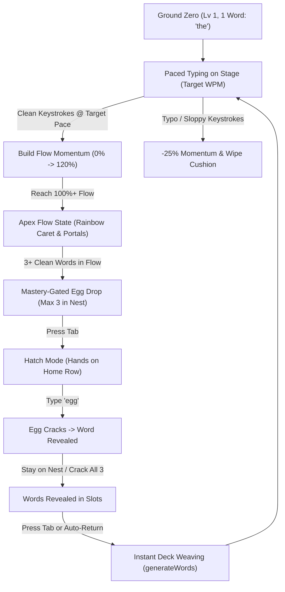
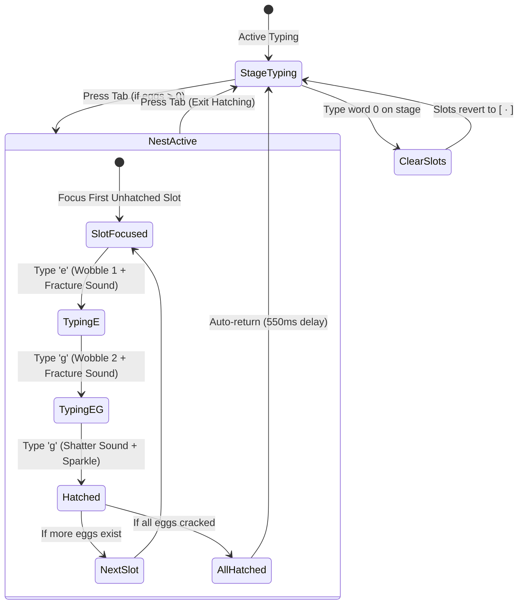

# TypeFlow ⚡ Design Document & Architectural Specification

**Version:** 2.0  
**Status:** Living Design Document  
**Target Environment:** Offline Single-File HTML5 / Android WebKit / Modern Browsers  
**Aesthetic:** OLED True Black (`#000000`) & Electric Sky Blue (`#38bdf8`)  

---

## 1. Executive Summary & Product Vision (The North Star)

### 1.1 The Problem
Traditional typing trainers fall into two extremes:
1. **Clinical & Repetitive:** Modern minimal trainers (e.g. Monkeytype) have exceptional typing physics, but can feel sterile or aimless over long sessions.
2. **Gamified Gimmicks:** Typing games (e.g. Typer Shark, space shooters) add fun, but sacrifice typing ergonomics, introduce input lag, use unnatural word sequences, and disrupt flow state with jarring popups and cutscenes.

### 1.2 The Vision
**TypeFlow** fuses **Monkeytype-grade precision ergonomics** with a rhythmic **Kinetic Flow State Roguelike**. 
Instead of typing random words without purpose, the player embarks on an incremental journey starting from **Ground Zero (1 single word: *"the"*)** and unlocks a curated deck of the **1,000 most common English words**.

### 1.3 Core Design Pillars
1. **Never Leave the Home Row:** Every single interaction—typing, cracking eggs, switching slots, and restarting tests—is executable entirely via keyboard without moving hands to a mouse.
2. **Kinetic Momentum Over Rigid Binary Streaks:** Flow state is modeled like a spinning flywheel with rotational inertia, an analog ramp-up, and an "Apex Cushion" that dampens minor hesitations while heavily penalizing careless mistakes.
3. **Invisible Neuromuscular Intelligence:** Words are not just random vocabulary; they are classified into 5 distinct physical motor patterns (Keybr-inspired finger mechanics) that progressively train rhythm, hand alternation, pinky reaches, and double-taps.
4. **Zero Modals, Zero Clutter:** No intrusive fullscreen victory modals or inventory screens interrupt the flow. Everything happens in-situ right on the typing stage.
5. **Zero-Build, Pure Web Standards:** Runs completely standalone as a single, self-contained offline `index.html` with zero external npm dependencies, zero build pipelines, and instant loading on Android mobile/desktop.

---

## 2. Core Game Loop & Player Journey



### 2.1 Progression Phases
- **Phase I: Ground Zero (Lv 1–3, 1–10 Words):** Establishing baseline rhythm and finger placement on high-frequency home-row keys.
- **Phase II: The Alternating Flywheel (Lv 4–10, 11–50 Words):** Discovering left-to-right alternating words, unlocking Common/Uncommon tiers, learning to maintain 100% flow.
- **Phase III: Motor Expansion (Lv 11–25, 51–200 Words):** Branching into lateral reaches and suffix curls; mastering target speeds from 40 WPM to 60 WPM.
- **Phase IV: Vocabulary Mastery (Lv 25–50, 201–1,000 Words):** Deep Rare and Epic egg discovery, full mastery of 1,000 common English words, sustained high-velocity flow streaks.

---

## 3. Kinetic Flow Engine & Atmosphere

### 3.1 The Momentum Math Model
Flow momentum is tracked on a continuous scale from **0.0% to 120.0%**:
- **0% – 99%:** Sub-Flow building phase.
- **100%:** Nominal Max Flow threshold (unlocks $3.0\times$ XP multiplier, egg drop rolls, and prismatic rainbow caret).
- **100% – 120%:** **Apex Flywheel Cushion** (energy reservoir banking over-spin momentum).

#### Granular Difficulty Control (Slider + Freeform Input)
The target pace is no longer constrained to stepped preset buttons. The header provides:
- **Analog OLED Slider:** Spans **15 to 120 WPM** with single-WPM precision.
- **Direct Number Input Box:** Allows custom values beyond 120 WPM (up to 300 WPM).
- **Bidirectional Sync:** Dragging the slider live-updates the text box; typing in the box live-updates the slider. Board keystrokes (<kbd>Space</kbd>, <kbd>Backspace</kbd>, letters) are isolated while focusing the input.

#### Calibrated Cadence Pace Formula
Previously, short words (e.g. 3-letter words) inflated burst speed because elapsed time was measured only from the first letter typed, ignoring pauses between words. To ensure Flow WPM accurately matches Classic mode typing speeds, pace is computed across the full inter-word cycle:

$$\Delta t_{\text{cycle}} = \max\left(0.20, \, \frac{t_{\text{now}} - t_{\text{lastWordEnd}}}{1000}\right)$$
$$\text{WordCadenceWPM} = \text{round}\left(\frac{\text{WordLength} + 1}{5} \times \frac{60}{\Delta t_{\text{cycle}}}\right)$$
$$\text{LiveWPM} = \text{round}\left(0.5 \times \text{WordCadenceWPM} + 0.5 \times \text{InstantaneousWPM}\right)$$

This penalizes hesitation between words, preventing players from coasting at inflated speeds.

#### Inhale Dynamics (Ramping Up to 100%)
Starting from a dead stop has weight. Overcoming static friction requires rhythmic cadence over ~10 words:
$$\Delta M_{\text{clean}} = 6.0 + \left(\frac{\min(100, M)}{100}\right) \times 10.0 + \text{SpeedBonus}$$
where:
$$\text{SpeedBonus} = \min\left(5.0, \, \max\left(0, \frac{\text{LiveWPM} - \text{TargetWPM}}{\text{TargetWPM}} \times 8.0\right)\right)$$

#### Stumble Damping vs. Exhale
When a word is typed cleanly but slightly below target pace:
- If banked inside the Apex Cushion ($M \ge 100\%$): momentum drops by only $-8.0\%$. A player at $115\%$ drops to $107\%$, keeping them above $100\%$ Max Flow with rainbow caret unbroken!
- If below $100\%$: momentum drops by $-12.0\%$.

#### Punishing Mistakes (Typos $\neq$ Flow)
Uncorrected errors committed on `<Space>` immediately:
1. **Wipe the Apex Cushion** (any momentum $>100\%$ is zeroed).
2. Subtract a severe **$-25.0\%$ momentum penalty**.
3. Reset `flowStreak` and `consecutiveCleanWords` to 0.
4. Extinguish the rainbow caret and drop the multiplier.

#### Kinetic Resting Inertia & Idle Decay
Friction only applies after an idle grace period that scales with momentum:
- At $\ge 100\%$ Flow: **3.0s grace period** before decay begins.
- At $\ge 50\%$ Flow: **2.2s grace period**.
- At $< 50\%$ Flow: **1.6s grace period**.
Decay follows a non-linear convex rate: gentle bleed ($-3.5\%/\text{sec}$) for the first 2 seconds of inactivity, accelerating to $-7.5\%/\text{sec}$ on prolonged pauses.

### 3.2 Atmosphere & Visual Shaders
- **4-Corner Electric Blue Portals:** Rendered via `.flow-vignette-overlay::before` using 4 corner radial gradients. Intensity is driven smoothly by CSS variable `--portal-alpha` (0.00 at 10% momentum $\rightarrow$ 0.75 at 100%).
- **Multi-Depth Perimeter Glow:** Rendered via `.flow-vignette-overlay::after` using inset cyan and teal box-shadows. Intensity is driven by `--vignette-alpha` (0.00 at 15% momentum $\rightarrow$ 0.55 at 100%).
- **Organic Breathing Pulse:** At $\ge 70\%$ flow, `.flow-vignette-overlay.breathing` triggers a GPU-accelerated 3.4-second sine-wave cycle (`filter: brightness(0.9) <-> brightness(1.28)` and subtle scale expansion).
- **Analog Peripheral Dimmer:** Continuous dial dimming header, footer, and brand logo from $100\%$ opacity down to $32\%$ (`--focus-opacity`) as momentum climbs, focusing total visual attention on the typing stage.
- **Barber Shop Rainbow Spiral Caret:**
  - $85\% – 99\%$: Pre-flow crisp anticipation aura (`.caret-flow-high`).
  - $100\%+$: Rotating rainbow spiral traveling downwards in a GPU-accelerated barber shop pole loop (`@keyframes barberPoleDown`) with $2\times$ elongated color bands ($8\text{px}$ per color) and subtle edge luminescence (`box-shadow: 0 0 5px rgba(56, 189, 248, 0.8), 0 0 9px rgba(255, 0, 85, 0.35)`).

---

## 4. Algorithmic Motor Classifier & Hybrid Dictionary Sorter

### 4.1 Hybrid Biomechanical & Frequency Dictionary Sorter (`words.js`)
Rather than relying on flat English frequency ordering, TypeFlow executes a runtime **Hybrid Sorter** that scores and re-orders the 1,000 words in `<2ms`:
- **Preserve Essential Connectors:** High-frequency functional words (*the, of, and, to, he, it, for, as*) remain unlocked early.
- **Physical Friction Re-weighting:** Awkward physical movements (e.g. pinky reaches, hurdle hops, double bounces) are pushed further back into higher tiers.
- **Pin Ground Zero:** Rank 1 is strictly locked to `"the"` with $\text{compositeScore} = -1$ to preserve the Level 1 starting state.
- **Endgame Integrity:** The Epic tier (#701–1,000) guarantees polysyllabic, reach-heavy motor patterns rather than trivial short words (*particularly, environment, commercial, investment, collection*).

### 4.2 Biomechanical Typability & Smoothness Sort Model (`score_words.py`)
Rather than sorting words strictly by total character count (which erroneously pushed 2-letter words to the top), words are scored by **biomechanical typability friction** normalized per stroke and per transition:
1. **Normalized Key Effort:** $\bar{C}_{\text{key}} = \frac{1}{|w|} \sum_{c \in w} \left(\text{RowCost}[c] \times \text{FingerCost}[c] + \text{CenterStretch}[c]\right)$
2. **Normalized Transition Friction:** $\bar{C}_{\text{trans}} = \frac{1}{\max(1, |w| - 1)} \sum_{i=1}^{|w|-1} \text{trans}(w_i, w_{i+1})$
   - **Hand Alternation Bonus:** $-0.45$ (Fluid Left $\leftrightarrow$ Right hand transitions)
   - **Inward Roll Bonus:** $-0.20$ (Pinky/ring towards index finger)
   - **Double Letter Tap:** $+0.25$ (Bounce tap cadence)
   - **Outward Roll Friction:** $+0.35$ (Index towards outer fingers)
   - **Row Hurdle Jump Penalty:** $+1.50$ (Top $\leftrightarrow$ Bottom row skipping home row on same hand)
   - **Same-Finger Bigram (SFB) Penalty:** $+3.20$ (Same finger forced to jump between distinct keys)
3. **Typing Flow Cadence & Rhythm Factor ($C_{\text{cadence}}$):**
   - **Length 4–6:** $+0.00$ (Optimal flow zone: rolling finger phrases before a rhythmic spacebar tap)
   - **Length 3:** $+0.15$ (Common functional connectors)
   - **Length 2:** $+0.55$ (Spacebar hammering penalty: rapid 2-stroke cycles disrupt flow)
   - **Length 7:** $+0.15$, **Length 8:** $+0.35$, **Length 9+:** $+0.35 + 0.15 \times (|w| - 8)$ (Endurance fatigue)

$$D_{\text{raw}} = \bar{C}_{\text{key}} + \bar{C}_{\text{trans}} + C_{\text{cadence}}$$
$$\text{Ease} = 1.0 - \text{PercentileRank}(D_{\text{raw}}), \quad \text{Commonality} = 1.0 - 0.85 \times \frac{\text{freqIndex}}{999}$$
$$\text{UnlockPriority} = \text{Ease} \times \text{Commonality}$$

Rank 1 is strictly locked to `"the"` (Ground Zero). Words are partitioned into the 5-tier pyramid:
- `Rank 1 – 40`: `STARTER` (8 Base XP, smooth high-frequency words)
- `Rank 41 – 300`: `COMMON` (15 Base XP)
- `Rank 301 – 600`: `UNCOMMON` (35 Base XP)
- `Rank 601 – 850`: `RARE` (80 Base XP)
- `Rank 851 – 1000`: `EPIC` (180 Base XP, polysyllabic & awkward-reach words)

### 4.3 Neuromuscular Motor Pattern Classifier (`detectMotorTags`)
Evaluates each word against all 5 physical motor rules in strict priority order (1 $\rightarrow$ 5). Stores all matching patterns in `tags: []` (for SRS pattern heat spillover) and assigns `primaryPattern = tags[0]` (for UI chips, quests, and egg roll categorization):
1. **Double Bounce (`DOUBLE_BOUNCE`):** Matches `/([a-z])\1/` (consecutive identical letters) OR same-finger vertical hurdle bigrams (`/(ed|de|lo|ol|sw|ws|fr|rf|ju|uj|ki|ik)/`).
2. **Suffix & Inward Curl (`SUFFIX_CURL`):** Word length $\ge 5$ AND matches `/(ing|tion|ment|ight|ence|able|ness|ly|ed)$/`.
3. **Lateral & Pinky Reach (`REACH_PINKY`):** Matches `/[qzxj]/` OR contains $\ge 2$ characters from `/[qzxvpbjky]/g`.
4. **Hand Alternator (`ALTERNATING`):** Word length $\ge 4$ where $\ge 75\%$ of adjacent character transitions alternate between `LEFT_HAND` (`qwertasdfgzxcvb`) and `RIGHT_HAND` (`yuiophjklnm`).
5. **Home Core Flow (`HOME_CORE`):** Baseline fallback default if `tags.length === 0`.

### 4.4 Persistent Telemetry & Session Pattern Heat
#### Per-Word Persistent Telemetry (`userStats[rank]`)
Tracks both unfixed mistakes submitted on `<Space>` and fixed stumbles caught via `<Backspace>`:
- `seen`: Total completions count.
- `unfixedErr`: Decaying counter (+1.0 on uncorrected typo, -0.25 on clean hit at/above target pace without backspace, floor 0.0).
- `fixedErr`: Decaying counter (+1.0 on backspaced word, -0.35 on clean hit without backspace, floor 0.0).
- `avgWpm`: Exponential moving average ($\text{avgWpm} = \text{avgWpm} \times 0.7 + \text{wordWpm} \times 0.3$).
- `streak`: Consecutive clean, backspace-free completions at/above target pace.

#### Session Motor Bucket Heat (`patternHeat`)
In-memory real-time fatigue tracker across the 5 buckets ($0.0$ to $2.0$ cap):
- On error or backspace: increments `patternHeat[tag] += 0.3` for all tags in `wordObj.tags`.
- On clean hit at/above target pace: decays `patternHeat[tag] -= 0.05` (floor $0.0$).

### 4.5 Flow-Modulated SRS Weighted Generator
Prevents "SRS Death Spirals" by modulating difficulty weights based on live `flowMomentum`:

#### Dynamic Flow Governor (`challengeScale`)
- **Sub-Flow Runway ($M < 85\%$):** $\text{challengeScale} = 0.35$. Heavily dampens high-error words to give the player a smooth runway of mastered vocabulary to build cadence up to 100% flow.
- **Transition Zone ($85\% \le M < 100\%$):** $\text{challengeScale} = 0.85$.
- **Apex Testing Zone ($M \ge 100\%$):** $\text{challengeScale} = 1.25$. Player is cushioned by the Apex Flywheel; the engine actively serves weak words and heated motor patterns for mastery training.

#### Word Weight Calculation Formula
For each candidate word in `unlockedRanks`:
$$\text{curiosity} = \begin{cases} (4 - \text{seen}) \times 0.4 & \text{if } \text{seen} < 4 \\ 0 & \text{otherwise} \end{cases}$$
$$\text{errorWeight} = (\text{unfixedErr} \times 2.5) + (\text{fixedErr} \times 0.8)$$
$$\text{paceDeficit} = \begin{cases} \min\left(2.0, \frac{\text{targetWpm} - \text{avgWpm}}{\text{targetWpm}} \times 3.0\right) & \text{if } \text{avgWpm} < \text{targetWpm} \\ 0 & \text{otherwise} \end{cases}$$
$$\text{tagHeat} = \sum_{t \in \text{tags}} \text{patternHeat}[t]$$
$$\text{masteryDecay} = \begin{cases} (\text{streak} - 3) \times 0.1 & \text{if } \text{streak} > 3 \\ 0 & \text{otherwise} \end{cases}$$
$$\text{weight} = \max\left(0.3, \, 1.0 + \text{curiosity} + ((\text{errorWeight} + \text{paceDeficit} + \text{tagHeat}) \times \text{challengeScale}) - \text{masteryDecay}\right)$$

#### Anti-Clumping Cooldown Buffer
- Sliding array `recentHistory` tracks the last $K$ spawned words, where:
  $$K = \min\left(6, \, \lfloor |\text{unlockedRanks}| \times 0.6 \rfloor\right)$$
- Words in `recentHistory` are excluded from the candidate pool for the next draw. At Ground Zero Level 1 ($|\text{unlockedRanks}| = 1$), $K = 0$, allowing the single unlocked word to stream smoothly. At 2 words, $K = 1$, strictly alternating without immediate repeat. At $\ge 10$ words, $K = 6$.

---

## 5. In-Situ 3-Slot Egg Nest & Hatchery

### 5.1 Architecture & Ergonomics
The egg hatchery is embedded directly into the active typing gauge (`#flow-gauge`), completely eliminating modal dialogs and mouse navigation:
- **Hard Inventory Cap:** Exactly 3 nest slots (`[ 0 ] [ 1 ] [ 2 ]`). Once full, egg rolls are paused until a slot is cracked.
- **Mastery-Gated Drop Rate:**
  - Below $100\%$ Momentum: **$0.0\%$ chance**.
  - At $100\%+$ Momentum with $\ge 3$ clean words: scales from **$0.5\%$ up to $3.5\%$ max** ($+0.1\%$ per clean word, averaging 1 egg discovery every 35–45 clean words).
  - Level-Up Bonus: Guaranteed bonus egg upon reaching each new player level.

### 5.2 Hatching State Machine & Interaction


1. **Focus Nest:** Pressing <kbd>Tab</kbd> shifts active typing focus from the text board to the first unhatched slot in the nest.
2. **Crack Sequence:** The user types `e` $\rightarrow$ `g` $\rightarrow$ `g`:
   - `e`: Slot wobbles gently (`wobble-1`) and triggers crack tone.
   - `eg`: Slot fractures violently (`wobble-2`) with deeper pitch.
   - `egg`: Egg shatters with an ascending arpeggio fanfare; word is unlocked in storage and displays in the slot as `✨ [word]`.
3. **Multi-Egg Persistence:** After hatching an egg, the player **remains on the nest**! Focus automatically glides to the next egg slot, allowing the player to crack all 3 eggs in one continuous rhythm.
4. **Instant Deck Refresh:** When exiting hatch mode (either by cracking all eggs or pressing <kbd>Tab</kbd>), `generateWords()` is called immediately to refresh the stage text, instantly weaving the new vocabulary into the stream.
5. **Fluid Slot Cleanup:** Revealed words remain visible in their nest slots until the user completes their first word on the board, at which point the slots smoothly clear back to `[ · ]`.

---

## 6. Typing Precision Engine & Classic Mode

### 6.1 Viewport Anchoring & Caret Physics
- **Deterministic 3-Line Window:** The typing container dynamically measures line height. Lines 1 and 2 remain static; Line 3+ smoothly scrolls so the active word is always centered on Line 2.
- **Subpixel Caret Positioning:** Caret horizontal position tracks active character offset with smooth transitions; vertical repositioning locks synchronously with line scrolls to eliminate visual jitter.
- **Dynamic Error Clearance:** Backspacing into an errored word and fixing letters dynamically clears the `.error` class from both letter and word nodes.

### 6.2 Classic Mode Analytics
Classic mode runs standard timed benchmarks (15s, 30s, 60s) with advanced telemetry:
- **Cumulative Average WPM:** Solid electric cyan line.
- **Rolling 3-Second Pace:** Mint teal curve showing cadence spikes and dips.
- **Raw Keystroke Pace:** Muted dashed line.
- **Fixed vs. Unfixed Error Dots:** Emerald markers `#34d399` indicate errors caught and fixed; red markers `#f87171` indicate unfixed mistakes.
- **Interactive Inspection:** Full hover and touch tooltip displaying precise second-by-second performance.

### 6.3 Classic Mode Typability & Cadence Distribution
To ensure Classic mode feels exceptionally smooth rather than choppy or staccato:
- **Typability-Weighted Selection:** Word probability combines tier macro weight with a length typability multiplier:
  - $\le 2$ letters: $0.45\times$ (dampens rapid spacebar hammering)
  - $3$ letters: $0.80\times$ (moderates short connectors)
  - $4$–$6$ letters: $1.20\times$ (golden typing zone for rolling rhythm and sustained cadence)
  - $7$ letters: $1.00\times$, $8$ letters: $0.85\times$, $9+$ letters: $0.70\times$
- **Rhythm Composition:** 4–6 letter words represent $\approx 78\%$ of the generated text stream, with 2-letter words lowered to $\approx 1.5\%$.
- **Anti-Clumping Buffer:** Sliding buffer of 20 words strictly prevents consecutive duplicate words and clustering.

### 6.4 Global Keyboard Shortcuts
| Key Combo | Context | Action |
| :--- | :--- | :--- |
| <kbd>Tab</kbd> | Nest has eggs | Enters Hatch Mode (focuses active egg) |
| <kbd>Tab</kbd> | Inside Hatch Mode | Exits Hatch Mode, refreshes text, returns to typing |
| <kbd>Tab</kbd> | Nest empty / Classic | Restarts session (`resetTest`) |
| <kbd>Tab</kbd> + <kbd>Enter</kbd> | Anywhere | Immediate test restart |
| <kbd>Esc</kbd> | Inside Hatch Mode | Closes Hatch Mode back to typing |
| <kbd>Esc</kbd> | Inside Stats Modal | Closes Stats Modal back to typing |
| <kbd>Esc</kbd> | Normal typing | Restarts session (`resetTest`) |
| <kbd>Space</kbd> | Normal typing | Submits active word & advances |
| <kbd>Backspace</kbd> | Normal typing | Erases character or backs into previous errored word |

### 6.4 Mode Persistence & Startup Lifecycle Synchronization
To eliminate desynchronization glitches between HTML markup and the runtime engine upon cold starts and page reloads:
1. **Persistent Mode Key:** Active mode (`flow` or `classic`) is persistently stored in `localStorage` under `typeflow_active_mode` via `StorageManager.getActiveMode()` and `StorageManager.setActiveMode(mode)`.
2. **Dynamic Tab Synchronization:** `resetTest()` unconditionally synchronizes `tabClassic` and `tabFlow` `.active` classes alongside stage widgets (`flowGauge`, `flowTargetPill`, `timer`, `levelHudCard`), ensuring visual tabs and internal engine state are in 100% lockstep on every render.
3. **Unblocked Focus Overlay Lifecycle:** The dark blur overlay (`focusOverlay`) is dismissed upon every test reset and input focus request. The input blur handler is strictly gated to active running tests (`isTestActive && !isTestFinished`), preventing idle page reloads or cold starts from trapping the player under a dark blurred veil before they begin typing.
4. **Font & Subresource Alignment:** Layout and caret positions listen for `document.fonts.ready` and `window.load` to deterministically re-align caret geometry after asynchronous web font hydration.

---

## 7. Web Audio Sound Synthesis

TypeFlow uses pure Web Audio API synthesis without external `.mp3` or `.wav` sound files:
- **Keystroke Click:** High-frequency filtered sine pulse (480 Hz base, decaying in 35ms).
- **Melodic Streak Pitching:** Keystroke frequencies scale up musical semitones with flow streak:
  $$f = f_{\text{base}} \times 2^{\frac{\min(18, \text{streak})}{12}}$$
- **Fracture Wobble:** Low-pitch triangle wave (240 Hz ramping exponentially down to 80 Hz in 80ms).
- **Hatch Fanfare:** Ascending 4-tone major chord arpeggio (`A4` 440 Hz $\rightarrow$ `C#5` 554 Hz $\rightarrow$ `E5` 659 Hz $\rightarrow$ `A5` 880 Hz).
- **Level-Up Fanfare:** 5-tone triumphant flourish with harmonic triangle overtone.
- **Egg Discovery Pop:** Dual-tone bell chime (`D5` 587 Hz + `A5` 880 Hz).

---

## 8. File Structure & Bundling Architecture

```
lively-nobel/
├── index.html       # Standalone distribution bundle (generated by build.py)
├── style.css        # OLED CSS styling, animations, portals, & layout
├── words.js         # Ranked 1,000 dictionary, tiers, motor buckets, & SRS generator
├── storage.js       # LocalStorage manager, save state migrations, & analytics
├── app.js           # Engine state machine, keyboard handler, & physics ticker
├── build.py         # Zero-dependency bundling script (combines assets into index.html)
├── README.md        # User-facing manual and feature overview
└── DESIGN.md        # This architectural design and specifications document
```

### 8.1 Single-File Offline Guarantee
Android WebViews and local browser tabs loading via `file://` or `content://` URIs often block separate CSS or JavaScript files due to CORS/security sandbox restrictions. `build.py` automatically inlines `style.css`, `words.js`, `storage.js`, and `app.js` into `index.html`. This ensures the application runs with 100% functionality on any device without a local web server.

---

## 9. Future Roadmap & Design Backlog

### Phase 1: High Priority (Polish & Gameplay Feel)
- [ ] **Rhythm Surge / Speed Trial Mode:** Special 30-second speed burst events triggered at high levels to test maximum burst typing.
- [ ] **Soundfont Profiles:** Optional mechanical switch sound presets (e.g. *Thocky Topre*, *Clicky Blue*, *Soft Marimba*).
- [ ] **Motor Mastery Quests:** Explicit challenges (e.g., *"Hatch 5 Alternating words"*, *"Reach 60 WPM on Suffix Curls"*).

### Phase 2: Medium Priority (Customization & Themes)
- [ ] **Cosmetic Color Themes:** Alternative high-contrast themes (*Void Amber*, *Neon Cyberpunk*, *Matrix Phosphor*).
- [ ] **Custom Vocabulary Packs:** Ability to upload custom text or code syntax (JavaScript, Python keywords) into the SRS engine.
- [ ] **Offline Export/Import:** JSON save state export and import to sync progression across multiple devices.
