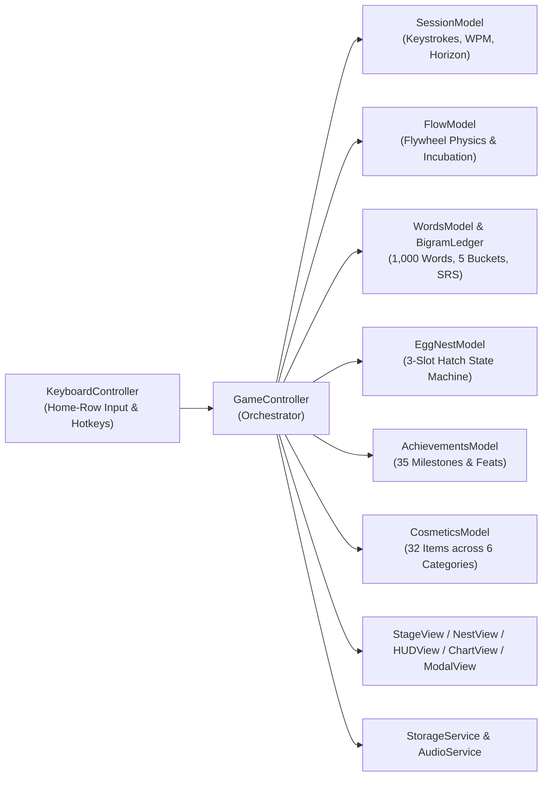

<div align="center">

# ⚡ TypeFlow

**The OLED Kinetic Typing Trainer & Incremental Flow-State RPG**

[](https://nowitstime.github.io/typeflow/)
[](#-testing--verification)
[](#%EF%B8%8F-architecture--engineering)
[](LICENSE)

*Begin at Ground Zero with a single word (`"the"`). Spin up the momentum flywheel, incubate word eggs directly on the home row, master 5 physical finger-motion buckets, race a 60fps ghost pacer, train working memory in Hidden Horizon mode, unlock all 1,000 words of the Grand Lexicon, and equip procedural cosmetics in the Cosmetic Armory.*

[**🚀 Launch Live App**](https://nowitstime.github.io/typeflow/) · [**📚 Wiki**](./wiki/Home.md) · [**🎨 Armory**](#-cosmetic-armory--customization-engine) · [**🏆 Achievements**](#-achievement-system--trophy-case) · [**🏛️ Architecture**](#%EF%B8%8F-architecture--engineering) · [**⌨️ Shortcuts**](#%EF%B8%8F-keyboard-shortcuts)

</div>

---

## 📖 Table of Contents

- [Overview](#-overview)
- [Core Game Modes](#-core-game-modes)
  - [🎮 Flow RPG Mode (Incremental Skill Engine)](#-1-flow-rpg-mode-incremental-skill-engine)
  - [⏱️ Classic Mode (15s / 30s / 60s Time Trials)](#%EF%B8%8F-2-classic-mode-15s--30s--60s-time-trials)
- [Advanced Training Modifiers](#-advanced-training-modifiers)
  - [🕶️ Dual-Mode Hidden Horizon](#%EF%B8%8F-hidden-horizon-working-memory--blind-touch-typing)
  - [👻 60fps Ghost Cursor Pacer](#-60fps-ghost-cursor-pacer)
- [🏆 Achievement System & Trophy Case](#-achievement-system--trophy-case)
- [🎨 Cosmetic Armory & Customization Engine](#-cosmetic-armory--customization-engine)
- [🏛️ Architecture & Engineering](#%EF%B8%8F-architecture--engineering)
- [🧪 Testing & Verification](#-testing--verification)
- [🛠️ Quick Start & Building](#%EF%B8%8F-quick-start--building)
- [⌨️ Keyboard Shortcuts](#%EF%B8%8F-keyboard-shortcuts)
- [🗺️ Roadmap](#%EF%B8%8F-roadmap)
- [📚 Multi-Page Wiki (`wiki/`)](./wiki/Home.md)

---

## 🌟 Overview

**TypeFlow** fuses the precision telemetry of **Monkeytype**, the biomechanical training of **Keybr**, and the tactile progression of an incremental roguelike—wrapped in an **OLED True Black (`#000000`) & Electric Sky Blue (`#38bdf8`)** interface.

Built from the ground up in **vanilla ES6 JavaScript** with **zero external runtime dependencies**, the entire application—including a 1,000-word categorized lexicon, procedural Web Audio API sound synthesizer, canvas telemetry charts, 32-item cosmetic armory, and observable MVC engine—compiles into a single portable `index.html` (~402 KB) that runs anywhere offline or online.

---

## ✨ Core Game Modes

### 🎮 1. Flow RPG Mode (Incremental Skill Engine)

| Mechanic | How It Works |
| :--- | :--- |
| **Ground Zero Start** | Begin your journey at Level 1 with **a single word (`"the"`)**. Zero cognitive overload—establish pure baseline rhythm and posture first. |
| **Weighted Flywheel Physics (`0%–120%`)** | Replaces brittle binary streak resets with rotational inertia. Clean paced hits accelerate the flywheel to **100% Flow** (~10 words) and bank up to **120% Apex Cushion**. |
| **Apex Cushion & Stumble Damping** | Operating in the `100%–120%` overspin buffer dampens pace stumbles from `-12%` down to `-8%`, absorbing brief hesitations without breaking your prismatic rainbow caret. |
| **Deterministic Egg Incubation** | Typing in Flow (`≥100%`) charges an under-stage incubation bar with bonus surges for clean streaks (`5+`, `10+`, `15+`), Apex overspin, and velocity bursts (`≥1.25×` target WPM). |
| **In-Situ 3-Slot Egg Nest** | Up to 3 eggs materialize directly on the stage (`[🥚][🥚][🥚]`). Press <kbd>Tab</kbd> anytime to focus a slot and type **`e` · `g` · `g`** to fracture the shell and hatch a new word without lifting your hands from the home row. |
| **Sandwiched Word Induction** | Newly hatched words are woven into your active typing stream inside a `[Familiar Anchor, New Word, Familiar Anchor]` triad so your fingers practice transitions in context. |
| **5 Keybr Motor Buckets & N-Gram Ledger** | All 1,000 words are classified across 5 physical touch-typing patterns (**Home Core**, **Hand Alternators ⚡**, **Suffix Curls 🌀**, **Lateral Reach 🎯**, **Double Bounce 💥**) paired with a rolling **Exponential Moving Average (EMA) Bigram Ledger** that targets your weakest two-letter transitions. |
| **Spaced Repetition System (SRS)** | Per-word telemetry tracks clean streak, average WPM, fixed backspaces, and unfixed errors—automatically scheduling struggling words more frequently until mastered. |

### ⏱️ 2. Classic Mode (15s / 30s / 60s Time Trials)

- **Tier-Weighted Macro Sampling**: Draws from the 1,000-word lexicon (60% Common, 25% Uncommon, 12% Rare, 3% Epic) with a 20-word anti-clumping ring buffer and a 60-word lookahead stage buffer that eliminates third-line layout gaps.
- **Cross-Word Backspace Revert**: Press <kbd>Backspace</kbd> at index `0` of the current word to step back into previously submitted words, fix typos, and dynamically clear error underlines.
- **Multi-Curve Canvas Telemetry**:
  - **Cumulative Average WPM** (solid electric cyan `#38bdf8`)
  - **Rolling 3-Second Instantaneous Pace** (mint teal `#2dd4bf`)
  - **Raw Keystroke WPM** (dashed slate)
  - **Fixed vs. Unfixed Error Markers**: Emerald (`#34d399`) vs. coral (`#f87171`) point indicators with interactive hover tooltips.

---

## 🔥 Advanced Training Modifiers

### 🕶️ Hidden Horizon (Working Memory & Blind Touch-Typing)
Toggle **Hidden Mode** in the top bar to train visual lookahead and muscle memory across two distinct sub-modes:
1. **Character Horizon (`Char`)**: A progressive fog curtain follows your caret. As your consecutive character combo climbs, the visibility horizon tightens toward zero, challenging you to trust pure proprioception.
2. **Word Vanish (`Words: 1–6`)**: Masks upcoming words beyond a configurable lookahead window (`1` to `6` words ahead), training your eyes to read ahead and buffer whole words in working memory while your fingers execute the current word.

### 👻 60fps Ghost Cursor Pacer
Enable the **Ghost Cursor** (`15–200 WPM`) to summon a subpixel-interpolated rival caret that glides smoothly across words at your target cadence:
- **Dynamic Activity Lifecycle**: Starts on your first keystroke, pauses gracefully after `400ms` of hesitation, and resets cleanly to your caret after `1.2s` of idle time.
- **Mid-Stream Induction Sync**: Automatically adjusts cumulative character offsets when new RPG word sandwiches are spliced into the active stage.

---

## 🏆 Achievement System & Trophy Case

TypeFlow features **35 hand-crafted achievements** across **7 categories**, designed around **Tier I (Entry)** and **Tier II (Mastery)** pairings and multi-test consistency counters to reward genuine skill milestones without notification spam.

| Category | Tier I (Entry) Examples | Tier II (Mastery) & Special Milestones |
| :--- | :--- | :--- |
| **⚡ Speed & Cadence** | **Cruising Altitude** (`5` tests at `≥60 WPM`)<br>**Steady Cadence** (`3` tests at `≥85%` consistency) | **Triple Digit Club** (`5` tests at `≥100 WPM`)<br>**Human Metronome** (`5` tests at `≥92%` consistency)<br>**Terminal Velocity** (`130+ WPM` burst in `120%` Apex) |
| **🌊 Flow & Flywheel** | **Sustained Current** (`30s` continuous Flow)<br>**Redline Runner** (`10` words at `120%` Apex)<br>**Silver Stream** (`50` clean Flow streak) | **Zen Master** (`120s` continuous Flow)<br>**Overclocked** (`30` words at `120%` Apex)<br>**Unbroken Stream** (`100` clean Flow streak) |
| **🎯 Precision & Recovery** | **Marksman** (`5` tests at `≥98%` accuracy)<br>**Quick Patch** (Fix `3+` typos, finish with `0` unfixed) | **Surgical Precision** (`3` tests at **100% True Raw** accuracy — `0` typos, `0` backspaces)<br>**Clutch Recovery** (Fix `6+` typos, finish with `0` unfixed) |
| **🕶️ Hidden Horizon** | **Vanishing Act** (`20` words, distance `2+`)<br>**Shadow Walker** (`35` char combo)<br>**Blind Typist** (`3` tests or `75` Flow words) | **Mind Palace** (`25` words, distance `4+`)<br>**Into the Fog** (`70` char combo)<br>**True Sight** (`60s` test at `≥98%` acc or `150` Flow words) |
| **👻 Ghost Pacer** | **Rabbit Chaser** (Outpace `60+ WPM` Ghost across `30s` test or `35` Flow words) | **Shadow Boxer** (Outpace `85+ WPM` Ghost across `30s` test or `50` Flow words) |
| **🥚 Lexicon & RPG** | **Nest Tender** (`15` eggs hatched)<br>**Lexicon Explorer** (`50` words unlocked)<br>**Golden Discovery** (Hatch a Rare word)<br>**Tri-Core Flow** (Master `3` motor buckets) | **Grand Incubator** (`60` eggs hatched)<br>**Lexicon Architect** (`250` words unlocked)<br>**Mythic Discovery** (Hatch an Epic word)<br>**Five-Finger Pentathlon** (Master all `5` motor buckets) |
| **🌟 Signature Feats & Crown Jewel** | 🛡️ **Shock Absorber** (Absorb an Apex stumble into the `85%–99%` buffer and recover back to `100%`)<br>⚡ **In-Stride Crack** (Crack an egg via `Tab` $\rightarrow$ `e-g-g` and resume typing without dropping below `85%` Flow) | 🔮 **Sixth Sense** (Hatch an egg in Hidden Mode while maintaining an active combo)<br>🏛️ **The Grand Lexicon** (**Crown Jewel** — Unlock all **1,000 words** in the TypeFlow dictionary) |

- **Anti-Spam FIFO Toast Queue**: Displays at most one non-blocking micro-toast at a time (`3.5s` duration) in the top-right corner—never stealing focus or obscuring the word stage.
- **Procedural Web Audio Chimes**: Synthesizes a 3-note major triad for Tier I unlocks and a 5-note resonant arpeggio for Tier II, Signature Feats, and the Crown Jewel.
- **Retroactive Synchronization**: Automatically credits milestones earned in existing saves upon boot.

---

## 🎨 Cosmetic Armory & Customization Engine

TypeFlow features a modular **Cosmetic Armory** with **32 procedural cosmetics** across **6 categories**, unlocked progressively via Player Level milestones and Trophy achievements. Equipped items apply instantly with dynamic CSS variable inheritance across all stage widgets and modals without page reload.

| Category | Available Options | Unlocking & Mechanics |
| :--- | :--- | :--- |
| **🎨 OLED Themes (6)** | **Electric Sky** (Default OLED Cyan), **Sakura Stream** (Lv. 3), **Phosphor CRT** (Lv. 6), **Cyberpunk Neon** (Lv. 10), **Nord Frost** (Lv. 15), **Obsidian Gold** (Lv. 25) | Live `--main-color`, `--bg-color`, and `color-mix()` inheritance across all modals, charts, buttons, and HUD badges. |
| **🌌 Flow FX Atmospheres (6)** | **Adaptive Resonance** (Default), **Prismatic Aurora** (Lv. 5), **Cyberpunk Grid** (Lv. 8), **Solar Flame / Inferno** (Lv. 14, SVG `<feTurbulence>`), **Hyperdrive Speedlines** (Lv. 20), **Zen Trance** (Trophy: *Zen Master*) | Full-viewport reactive corner portals, perimeter vignettes, and procedural particle shaders scaling with momentum. |
| **📍 Caret Geometries (5)** | **Line** (3px Bar), **Low-Profile Runner** (Full-width underline), **Classic Terminal** (Full-character block), **Capsule** (Pill runner), **Permanent Prism** (Lv. 12 or *Zen Master*) | Subpixel-smooth physical cursor geometry with automatic character tracking and line-centering. |
| **✨ Caret FX Modifiers (6)** | **Clean Solid** (Default), **Prismatic Rainbow** (Chromatic spectrum), **Plasma Overdrive** (Pulsing high-voltage aura), **Solar Flare** (Fiery speed-reactive gradient), **Holo Glitch** (Chromatic aberration jitter), **Hyperdrive Tracer** (Multi-segment motion blur) | Universal visual overlays that augment whichever caret geometry is currently equipped. |
| **👻 Ghost Pacer Styles (4)** | **Ghost Line** (Default mist bar), **Ghost Runner** (Underline skimming shadow), **Ghost Terminal** (Hollow terminal box), **Ghost Halo** (Hovering rhythm orb) | Customizes the 60fps virtual pacer rival to match personal visual preferences. |
| **🔊 Switch Sound Packs (5)** | **Default Box Blue** (Crisp clicky), **Thoccy Linear** (Deep muted thoc), **Tactile Brown** (Subtle bump), **Typewriter Bell** (Retro striker impact), **Bubble Droplet** (Soothing organic droplet clicks) | 100% procedurally synthesized Web Audio API sound engines with semitone frequency scaling on active streaks. |

---

## 🏛️ Architecture & Engineering

TypeFlow uses a clean, decoupled **Observable Model-View-Controller (MVC)** architecture where all domain models are 100% headless and DOM-independent.



### Repository Structure

```text
lively-nobel/
├── src/
│   ├── core/
│   │   ├── Constants.js          # Enums, motor bucket metadata & configuration
│   │   └── EventEmitter.js       # Lightweight pub/sub event bus
│   ├── models/
│   │   ├── WordsModel.js         # 1,000-word lexicon, motor buckets, SRS & sandwiching
│   │   ├── BigramLedger.js       # Rolling EMA character-transition mastery ledger
│   │   ├── FlowModel.js          # Kinetic flywheel physics, Apex cushion & egg charge
│   │   ├── SessionModel.js       # Keystroke engine, cross-word revert & live WPM
│   │   ├── EggNestModel.js       # 3-slot in-situ egg nest & 'e-g-g' fracture state machine
│   │   ├── AchievementsModel.js  # 35 achievements, Tier I/II math & progress evaluator
│   │   └── CosmeticsModel.js     # 32 procedural cosmetics across 6 categories & unlock rules
│   ├── services/
│   │   ├── StorageService.js     # Resilient localStorage persistence + memory fallback
│   │   └── AudioService.js       # Web Audio API harmonic key clicks & unlock synthesizers
│   ├── views/
│   │   ├── StageView.js          # 3-line word viewport, subpixel caret & ghost pacer
│   │   ├── NestView.js           # 3-slot egg nest UI, incubation bar & fracture FX
│   │   ├── HUDView.js            # Atmosphere vignette, mode bar & FIFO achievement toasts
│   │   ├── ChartView.js          # Multi-curve canvas telemetry graph & hover tooltips
│   │   └── ModalView.js          # 4-tab Lifetime Stats & Armory modal (RPG, Classic, Trophies, Armory)
│   ├── controllers/
│   │   ├── KeyboardController.js # Keystroke routing, input isolation & shortcuts
│   │   └── GameController.js     # Central coordinator, physics ticker & telemetry wiring
│   └── bootstrap.js              # Dependency injection & startup lifecycle
├── tests/
│   ├── unit_models_test.js       # Headless unit tests for core models (55 tests)
│   ├── services_test.js          # Storage fallback, SRS & audio synth tests (16 tests)
│   ├── views_test.js             # DOM-isolated view rendering tests (16 tests)
│   ├── controllers_test.js       # Controller state machine & integration tests (23 tests)
│   ├── cosmetics_test.js         # Cosmetic Armory, unlocks & style application (9 tests)
│   ├── ghost_cursor_test.js      # 60fps ghost pacer & sandwich sync tests (12 tests)
│   ├── bug_fixes_test.js         # Cross-mode & edge-case verification (12 tests)
│   ├── recent_bugfixes_test.js   # Timer, word revert & deck explorer tests (9 tests)
│   ├── edge_cases_stress_test.js # High-velocity burst & storage corruption tests (8 tests)
│   └── achievements_test.js      # Achievements, toasts, trophies & retro-sync (17 tests)
├── build.py                      # Zero-dependency single-file bundler -> index.html
├── index.html                    # Standalone distributable (~402 KB, works via file://)
├── style.css                     # OLED True Black theme, animations & responsive HUD
└── README.md                     # Project documentation
```

---

## 🧪 Testing & Verification

TypeFlow is backed by **10 automated headless test suites** (**180 assertions total, 100% pass rate**) running directly in Node.js with zero external test runner dependencies.

```bash
# Run all 10 test suites at once
for test in tests/*_test.js; do node "$test"; done
```

Or run individual suites:

```bash
node tests/unit_models_test.js       # 55 tests — Words, Flow, Session, EggNest & Bigram models
node tests/services_test.js          # 16 tests — StorageService & Web Audio synthesis
node tests/views_test.js             # 16 tests — Stage, Nest, HUD, Chart & Modal views
node tests/controllers_test.js       # 26 tests — GameController, KeyboardController & Flow Recap
node tests/cosmetics_test.js         #  9 tests — Cosmetic Armory, unlocks & style application
node tests/ghost_cursor_test.js      # 12 tests — Ghost pacer physics & sandwich offset sync
node tests/bug_fixes_test.js         # 12 tests — Cross-mode & boundary regressions
node tests/recent_bugfixes_test.js   #  9 tests — Classic timer, revert & deck filters
node tests/edge_cases_stress_test.js #  8 tests — 300 WPM stress bursts & storage resilience
node tests/achievements_test.js      # 17 tests — 35 achievements, FIFO toasts & Trophy Case
```

---

## 🛠️ Quick Start & Building

### 1. Run Immediately
Because `index.html` is pre-bundled with all CSS and JavaScript inline, you can open it directly in any modern browser (`file:///...`) or serve it locally:

```bash
python3 -m http.server 8080
# Open http://localhost:8080
```

### 2. Rebuild Single-File Bundle
After editing any file under `src/` or `style.css`, regenerate the standalone `index.html`:

```bash
python3 build.py
```

---

## ⌨️ Keyboard Shortcuts

| Shortcut | Context | Action |
| :--- | :--- | :--- |
| <kbd>Char</kbd> | Typing Stage | Type character & advance subpixel caret |
| <kbd>Space</kbd> | Typing Stage | Submit current word & evaluate Flow / SRS telemetry |
| <kbd>Backspace</kbd> | Typing Stage | Delete character, or step back into previous word at index `0` |
| <kbd>;</kbd><kbd>;</kbd> | Flow Mode | Toggle the **Flow State Performance Recap & Timeline Graph** |
| <kbd>Tab</kbd> | Flow Mode (Eggs in Nest) | Enter **Hatch Mode** and focus the first available egg slot |
| <kbd>e</kbd> $\rightarrow$ <kbd>g</kbd> $\rightarrow$ <kbd>g</kbd> | Hatch Mode Active | Fracture and hatch the focused egg to unlock a new word |
| <kbd>Tab</kbd> / <kbd>Esc</kbd> | Hatch Mode Active | Exit Hatch Mode and return to the typing stage |
| <kbd>Tab</kbd> | Classic Mode / Empty Nest | Quick-restart the current typing session |
| <kbd>Esc</kbd> | Modal / Recap Open | Dismiss Flow Recap or close the Lifetime Stats / Trophy Case / Armory modal |

---

## 🗺️ Roadmap

- [x] **v1.0 — Core Classic & Flow RPG Engine**: 1,000-word lexicon, flywheel momentum, and OLED theme.
- [x] **v2.0 — Keybr Motor Buckets & In-Situ Egg Nest**: 5 physical finger-pattern buckets, 3-slot keyboard-native hatching (`e-g-g`), and cross-word backspace revert.
- [x] **v3.0 — Observable MVC Refactor & Deterministic Incubation**: 15 modular ES6 classes, N-Gram Bigram EMA ledger, and sandwiched word induction.
- [x] **v3.5 — Dual-Mode Hidden Horizon, 60fps Ghost Pacer & 35-Trophy Achievement System**: Character Horizon, Word Vanish (`1–6` words), virtual pacer rival, and multi-tier Trophy Case.
- [x] **v4.0 — Cosmetic Armory & Atmospheric Flow Engine**: 32 items across 6 categories (Themes, Flow FX, Caret Geometries, Caret FX, Ghost Styles, Sound Packs), level/trophy unlock gating, and dynamic CSS palette inheritance.
- [x] **v4.1 — Flow State Performance Recap & Timeline Graph**: Qualifying Flow Run recorder ($\ge 85\%$ start, $\ge 50\%$ continuation floor), home-row `;;` shortcut & contextual nest pill, 7s AFK crossfade with zero-friction typing wake, and 15-run history table with unlocked deck size.

---

## 📄 License

Released under the **MIT License**. Crafted for typing enthusiasts, rhythm gamers, and developers.
